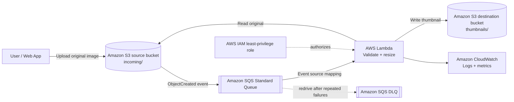

# Serverless Image Processing Pipeline on AWS
**AWS Solutions Architect – Associate Graduation Project**

## 1. Executive summary
This project designs an event-driven image-processing pipeline for an e-commerce or content platform. Users upload original images to Amazon S3. Amazon S3 publishes object-created events to an Amazon SQS Standard queue. AWS Lambda consumes queued events, validates and resizes supported images, and stores thumbnails in a separate S3 destination bucket. Failed messages can be retried and eventually moved to a dead-letter queue (DLQ).

The design separates upload from processing, allowing the queue to buffer bursts of uploads and Lambda to scale with demand.

## 2. Problem statement
Applications often need consistent image sizes for product listings and previews. Processing every upload synchronously can slow the upload experience and make the application less resilient during traffic spikes.

## 3. Objectives
- Process uploaded JPEG, PNG, and WebP images asynchronously.
- Generate thumbnails with a maximum dimension of 300 × 300 pixels while preserving aspect ratio.
- Store originals and processed images separately to prevent recursive processing.
- Use SQS buffering and a DLQ to improve resilience.
- Apply least-privilege IAM permissions, encryption, logging, and lifecycle controls.
- Document testing, monitoring, cost considerations, and future improvements.

## 4. Architecture
See [`docs/architecture.mmd`](docs/architecture.mmd). The architecture is also embedded here so it can be viewed directly in GitHub:



### Request flow
1. A user uploads an image to the **source S3 bucket**, under the `incoming/` prefix.
2. An S3 `ObjectCreated` notification sends an event to an **SQS Standard queue**.
3. **Lambda** polls the queue through an event source mapping.
4. Lambda reads the source image, validates its format and size, resizes it, and writes the thumbnail to the **destination S3 bucket** under `thumbnails/`.
5. Lambda writes execution logs to **CloudWatch Logs**. Messages that repeatedly fail are sent to the **dead-letter queue** according to the queue's redrive policy.

S3 notifications are at-least-once and can be delayed; consumers should be idempotent. Source and destination buckets are separate to avoid accidental recursive triggering.

## 5. AWS services and design choices
| Service | Responsibility | Design rationale |
|---|---|---|
| Amazon S3 (source) | Receives original images | Durable object storage and event notifications |
| Amazon SQS Standard | Buffers image events | Decouples uploads from processing and absorbs bursts |
| Amazon SQS DLQ | Holds repeatedly failed messages | Supports troubleshooting and controlled redrive |
| AWS Lambda | Validates and resizes images | Serverless execution without managing servers |
| Amazon S3 (destination) | Stores thumbnails | Separates generated output from original files |
| AWS IAM | Permissions for Lambda and S3-to-SQS | Least-privilege access |
| Amazon CloudWatch | Logs, metrics, alarms | Operational visibility |

**Optional extensions (not part of the minimum implementation unless deployed):** AWS Step Functions for multi-step workflows, DynamoDB for image metadata, API Gateway for pre-signed uploads, CloudFront for content delivery, and SNS for notifications.

## 6. Security
- Keep both buckets private; block public access.
- Enable S3 server-side encryption (SSE-S3 or approved KMS configuration).
- Grant the Lambda role read access only to the source bucket and write access only to the destination bucket.
- Grant S3 permission to send messages only to the intended SQS queue.
- Do not place access keys or secrets in source code.
- Validate file extension and actual image format; set a maximum input size and consider pixel-count limits to mitigate decompression bombs.
- Use CloudWatch logs and avoid logging image contents or sensitive metadata.

## 7. Reliability and scalability
- SQS buffers events during spikes and allows Lambda to process asynchronously.
- Configure a redrive policy with a DLQ and a sensible maximum receive count.
- Use a partial batch response or batch size 1 for a simple first implementation so one bad image does not unnecessarily fail unrelated records.
- Handle duplicate events safely. The deterministic output key `thumbnails/<source-key>.jpg` makes reprocessing predictable.
- Configure CloudWatch alarms for Lambda errors, queue age, and DLQ message count.

## 8. Cost considerations
The architecture uses pay-per-request/serverless services, but it is **not guaranteed to be free**. Costs may include S3 storage and requests, SQS requests, Lambda duration and requests, CloudWatch logs, data transfer, and any optional services. Check current pricing and your account's Free Tier eligibility before deployment. Set a billing budget alert, use small test images, and delete test resources after evidence is captured.

## 9. Implementation status
This repository contains the project design, Lambda source, a local unit test, and a deployment checklist. **Do not describe the system as deployed until you have deployed it and captured real test evidence.** The architecture diagram is a target architecture; mark each service as deployed only after verification.

## 10. Repository structure
```text
.
├── README.md
├── docs/
│   ├── architecture.mmd
│   └── deployment-checklist.md
├── src/
│   └── lambda_function.py
├── tests/
│   └── test_validation.py
└── requirements.txt
```

## 11. Local setup and tests
Requires Python 3.11+ and pip.

```bash
python -m venv .venv
# Windows PowerShell:
.venv\Scripts\Activate.ps1
# macOS/Linux:
# source .venv/bin/activate

pip install -r requirements.txt
python -m unittest discover -s tests -v
```

The unit test validates the input-key guard without calling AWS. A full end-to-end test requires an AWS account, deployed resources, IAM permissions, and a sample image.

## 12. Deployment plan
1. Choose one AWS Region and confirm account access and budget.
2. Create private source and destination S3 buckets.
3. Create an SQS Standard queue and a DLQ; configure the redrive policy.
4. Configure source-bucket `ObjectCreated` notifications for the queue, restricted to the `incoming/` prefix. Add the SQS queue policy allowing the S3 service principal to send messages from the source bucket.
5. Package the Lambda code and Pillow dependency for the Lambda runtime/architecture, or use a compatible Lambda layer/container image.
6. Create the Lambda execution role with CloudWatch Logs, source-object read, and destination-object write permissions.
7. Create an SQS event source mapping for Lambda. Start with batch size 1.
8. Upload a small test image to `incoming/`.
9. Verify the Lambda log stream and confirm a thumbnail appears in the destination bucket.
10. Test an unsupported file and confirm failure handling / DLQ behavior.
11. Capture screenshots of resources, successful output, and logs. Delete resources when no longer needed.

